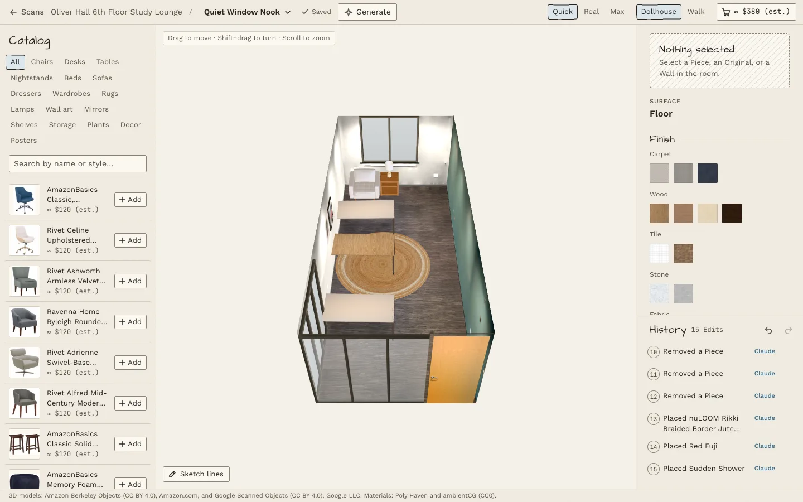
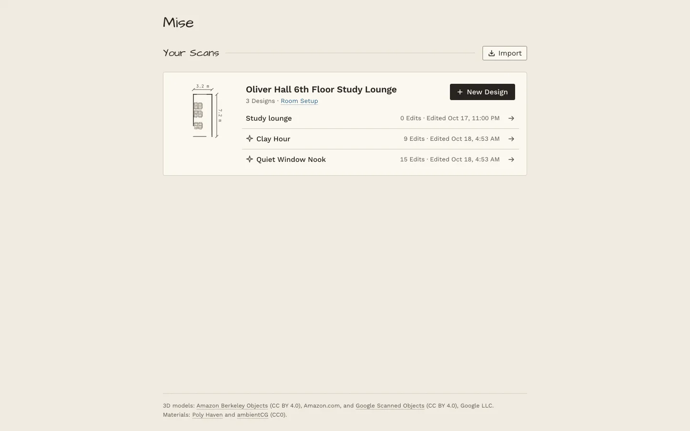

# Mise

**A sketchbook for your real room.** Scan your new room once, then redesign it with real products at real size, in a 3D copy of your actual room, before you buy anything or carry a single box.



Movers (a freshman furnishing a dorm, a new homeowner) buy furniture blind: will this desk fit, will this rug clash with the school's dresser, would the walls look better sage? In Mise they find out first:

- **Scan.** Capture the room once with an iPhone (Polycam or KIRI Engine), or start from your school's floor plan. Room Setup marks its floor, walls, doors, windows and the furniture already there (the Originals).
- **Design.** Place, move, swap and resize real products from the Catalog. Recolor single Parts (black legs, oak top), paint walls without losing the room's real light, and replace the room's own furniture. Fit rules flag a dresser that blocks the door.
- **Generate.** Write a Brief, like "cozy Japandi, under $400, I need a reading corner", and Claude makes three Designs that fit the room, Edit by Edit, as you watch.
- **Shop.** Every Design has a shopping list with product links and an estimated total.



**Live demo:** https://mise-dubhacks.azurewebsites.net (Room Setup and imports are off there; see [docs/deploy.md](docs/deploy.md)).

## Run it

Node 24 or later.

```sh
npm install
cp .env.example .env   # add ANTHROPIC_API_KEY (and ANTHROPIC_WORKSPACE_ID if your key needs one) for Generate
npm run dev            # the web app on http://localhost:5173, the API on :8787
```

Open http://localhost:5173, choose **Try the demo**, and pick a Design of the study lounge. Everything but Generate and text-to-3D works without keys.

| Command | What it does |
|---|---|
| `npm run dev` | Vite (web) and the Hono API, both reloading on change |
| `npm test` | The Vitest suite |
| `npm run typecheck` | `tsc --noEmit` |
| `npm run build && npm start` | The production build: one Node server for the web app, `/api` and `/data` |

## How it works

```
 iPhone capture or floor plan
          │  scripts/scan-import.ts, Import on Home
          ▼
 data/scans/<id>/     room mesh (GLB), splat, manifest.json, setup.json (Room Setup)
 data/catalog/        Catalog: items, optimized GLB models, thumbnails, estimated prices
 data/designs/        Designs: each one an Edit list (JSON)
          │
          │  GET /data/*   static files
          ▼
 server/ (Hono)       /api/scans, /api/designs     list, create, save
                      /api/generate                Brief → 3 Designs: Claude calls the same
                                                   Edit tools as the editor, streamed as NDJSON
          │
          ▼
 web/ (Vite, React, React Three Fiber)
   /                  the landing page, with the demo
   /scans             your Scans and their Designs, Import
   /setup/:scanId     Room Setup: floor, walls, Openings, Originals
   /d/:designId       the editor:  RoomState = replay(setup, catalog, edits)  →  render
                      every action appends an Edit; undo, History and Duplicate come free
 shared/              types, replay, Fit rules, Parts, Catalog search: used by web and server
```

Three ideas carry the design:

1. **A Scan is made once and never changed.** A Design is a list of Edits on top of it ([ADR-0001](docs/adr/0001-design-is-an-edit-list.md)), and what you see is `replay(edits)`.
2. **Claude and the Mover use the same Edit functions**, so a generated Design is just Edits the Mover can undo, change or keep. Fit rules run in both.
3. **The room stays photoreal; the chrome is a sketch.** The UI reads like an architect's concept drawing, so the real room is what stands out ([docs/design/sketch-style.md](docs/design/sketch-style.md)).

The words used in the code and UI (Mover, Scan, Design, Original, Piece, Part, Edit, Finish) are defined in [GLOSSARY.md](GLOSSARY.md). The full build spec is [.plans/mise-spec.md](.plans/mise-spec.md), and the decisions behind it are in [docs/adr/](docs/adr/).

## Credits

- **3D models and product photos:** [Amazon Berkeley Objects](https://amazon-berkeley-objects.s3.amazonaws.com/index.html) (CC BY 4.0), Amazon.com, and [Google Scanned Objects](https://app.gazebosim.org/GoogleResearch/fuel/collections/Scanned%20Objects%20by%20Google%20Research) (CC BY 4.0), Google LLC.
- **Materials:** [Poly Haven](https://polyhaven.com) and [ambientCG](https://ambientcg.com) (CC0).
- **Wall art and textiles:** public-domain museum works, each credited in its item's `attribution`; the rest were made for Mise.

Every Catalog item and its credit is listed in [data/catalog/CREDITS.md](data/catalog/CREDITS.md).

Built at DubHacks 2026.
